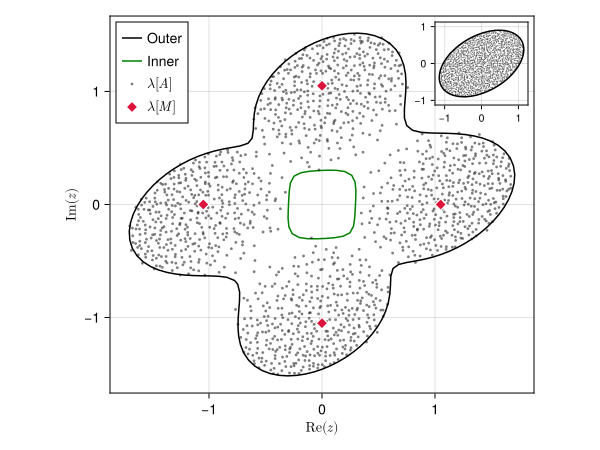
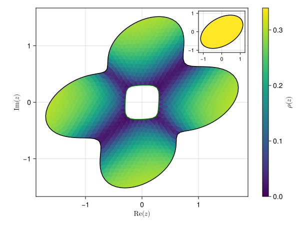
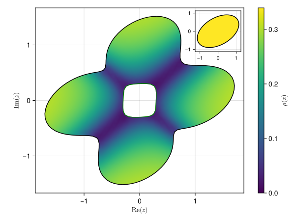
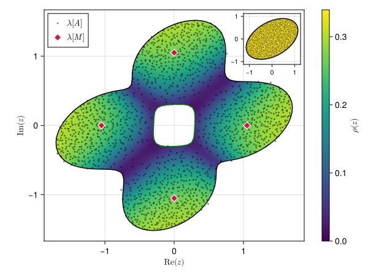

# GaussianSpectralDensities.jl

This repo contains code and notebooks to calculate and visualize spectral densities and boundaries of partially symmetric/Hermitian matrices for chapter 4 of my Ph.D. dissertation[^Wennberg2026Physical].

## Background

Consider a random matrix

$$
A = M + L J R ,
$$

where $M, L$ and $R$ are fixed square matrices of size $N \times N$, $L$ and $R$ are invertible, and $J$ is a sample from the elliptic (Girko) ensemble with parameter $\tau \in \mathbb{C}, |\tau| < 1$, where elements $J_{ij} \in \mathbb{C}$ are normally distributed with mean zero and the following nonzero covariances:

$$
\begin{aligned}
\langle |J_{ij}|^2 \rangle = \frac{1}{N} , \\
\langle J_{ij} J_{ji} \rangle = \frac{\tau}{N} .
\end{aligned}
$$

That is, each matrix element has variance $1 / N$, pseudo-covariance $\tau / N$ with its mirror image across the diagonal, and is independent from all other elements. As $\tau \to 1$ we obtain hermitian $J$ sampled from the grand unitary ensemble (GUE), and $\tau \to -1$ gives skew-hermitian $J$.

The setup is similar to Ahmadian et al. (2015)[^Ahmadian2015Properties], but generalizes the distribution of $J$ by introducing the pseudo-covariance $\tau$. The code and dissertation supports even more general $J$-ensembles, but we'll stick to the one-parameter elliptic (Girko) ensemble in this README.

We assume that $M, L$, and $R$ are defined in such a way that it is possible to take $N \to \infty$, and that certain matrix norms remain bounded in the limit. See Tao et al. (2010)[^Tao2010Random] for how to make these notions precise.

## Example

The following is a brief walkthrough of the calculations and visualizations in `notebooks/2026-02-21_high_level_API.jl`. A more practical example, where we study fixed point stability in a randomly coupled dynamical system, can be found in `notebooks/2026-02-25_CIM_tau_fixed_point.jl`.

Consider an ensemble with the following parameters:

$$
\begin{aligned}
M &= 1.05 \mathop{\mathrm{diag}}([1, i, -1, -i, \cdots]), \\
L &= R = I, \\
\tau &= \frac{e^{i \pi / 3}}{4}.
\end{aligned}
$$

Here, the pattern of $1,i,-1,-i$ is repeated all the way down the diagonal, such that $M$'s eigenvalues of are $\pm 1.05$ and $\pm 1.05 i$ with equal multiplicities $N / 4$.

We begin by defining the ensemble, sampling some eigenvalues, and calculating the boundary of the eigenvalue support:

```julia
using GaussianSpectralDensities:
    MatrixEnsemble,
    SpectralProblem,
    spectral_boundary,
    spectral_density,
    sample_eigenvalues,
    solve
using LinearAlgebra: I, Diagonal

# Define the ensemble and compute the eigenvalues of a sample at N = 1536
M = Diagonal([1.05, 1.05im, -1.05, -1.05im])
sqrt_τ = 0.5cispi(1//6)
e = MatrixEnsemble(M, I, I, sqrt_τ * I)
eigvals = sample_eigenvalues(e, 1536)

# Instantiate a SpectralProblem, which represents the problem of solving the
# self-consistent equations for the averaged resolvent at any point in the
# complex plane (you can do other things with these equations too, by passing an
# optional AbstractConstraint to the SpectralProblem constructor)
prob = SpectralProblem(e)

# "Solve" the problem, which in this context means roughly locating the spectral
# support from sampled eigenvalues, solving the self-consistent equations at a
# small number of points in this region, and generating a surrogate model,
# specifically a radial basis function interpolant, that approximates the
# solution at any other point to provide good initial guesses for downstream
# newton solves. This is packaged up in the returned SpectralModel instance,
# which is the jumping-off point for most downstream calculations.
model = solve(prob; hcoeff=3//2)

# Use the model to calculate the boundary of the spectral support
boundary = spectral_boundary(model; step_size_coeff=1//4)
```

Let's do the same calculations for $J$ alone, which has a known eigenvalue distribution: constant density in an ellipse that's centered on the origin, has semiaxes $1 \pm |\tau|$, and whose major axis sits at an angle $\mathop{\mathrm{arg}}(\tau) / 2$ to the real axis. In this case, that means semiaxes $(1.25, 0.75)$ and major axis at an angle $\pi / 6$ to the real axis.

```julia
eJ = MatrixEnsemble(0I, I, I, sqrt_τ * I)
eigvalsJ = sample_eigenvalues(eJ, 1536)
probJ = SpectralProblem(eJ)
modelJ = solve(probJ; hcoeff=3//2)
boundaryJ = spectral_boundary(modelJ; step_size_coeff=1//4)
```

The results look as follows (see notebook for plotting code):



The computed boundary matches the sampled eigenvalues at $N = 1536$ well, and the shape makes intuitive sense as roughly the union of four copies of $J$s ellipse (shown in the inset) centered on each of the four eigenvalues of $M$ (shown as crimson diamonds), albeit somewhat smeared together.

Next, we calculate the spectral density throughout the support.

```julia
msh = spectral_density(model; hcoeff=1//4)
mshJ = spectral_density(modelJ; hcoeff=1//4)
```

The function `spectral_density` generates a fine triangular mesh throughout the support, solves the self-consistent equations for the averaged resolvent at each vertex, calculates the eigenvalue density by approximating the requisite partial derivatives on each face, and returns an object of type `Mesh` (from [GeometryBasics.jl](https://juliageometry.github.io/GeometryBasics.jl/)) with vertex and face attributes holding the computed quantities.

Let's first visualize the mesh itself.


Next, let's see what the eigenvalue density looks like.



The mosaic style of this heatmap is a result of `msh.density` being a face attribute, and [Makie.jl](https://docs.makie.org/)'s mesh plotting functions taking face attributes to be piecewise constant. If we want a smooth heatmap, we can instead use the interpolated vertex attribute `msh.vertex_density` as data:



Finally, let's scatter the sampled eigenvalues over the heatmap as a visual confirmation of the plausible correctness of the calculated density.



[^Wennberg2026Physical]: Wennberg, Daniel. “Physical Optimizers beyond Landscapes and Bistability.” Stanford University, 2026. <https://doi.org/10.25740/xm811jn0959>.

[^Tao2010Random]: Tao, Terence, Van Vu, and Manjunath Krishnapur. “Random Matrices: Universality of ESDs and the Circular Law.” The Annals of Probability 38, no. 5 (2010): 2023–65. <https://doi.org/10.1214/10-AOP534>.

[^Ahmadian2015Properties]: Ahmadian, Yashar, Francesco Fumarola, and Kenneth D. Miller. “Properties of Networks with Partially Structured and Partially Random Connectivity.” Physical Review E 91, no. 1 (2015): 012820. <https://doi.org/10.1103/PhysRevE.91.012820>.
